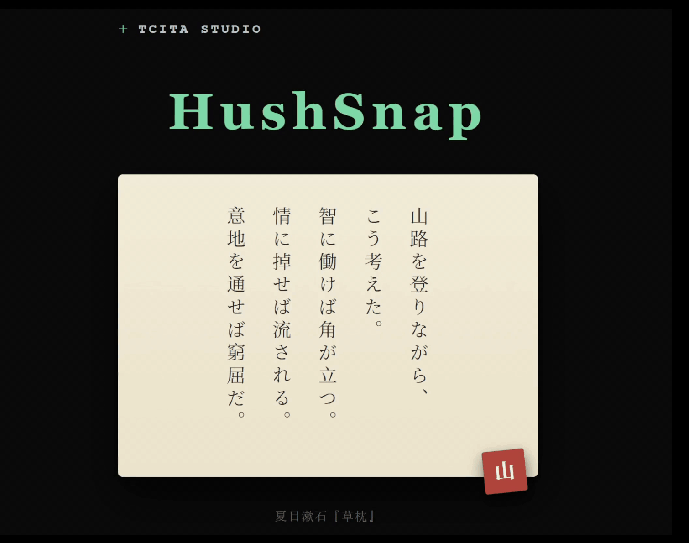
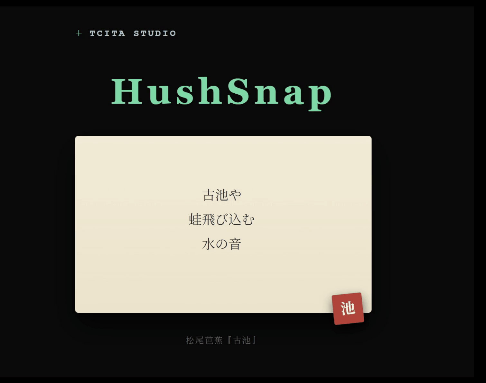
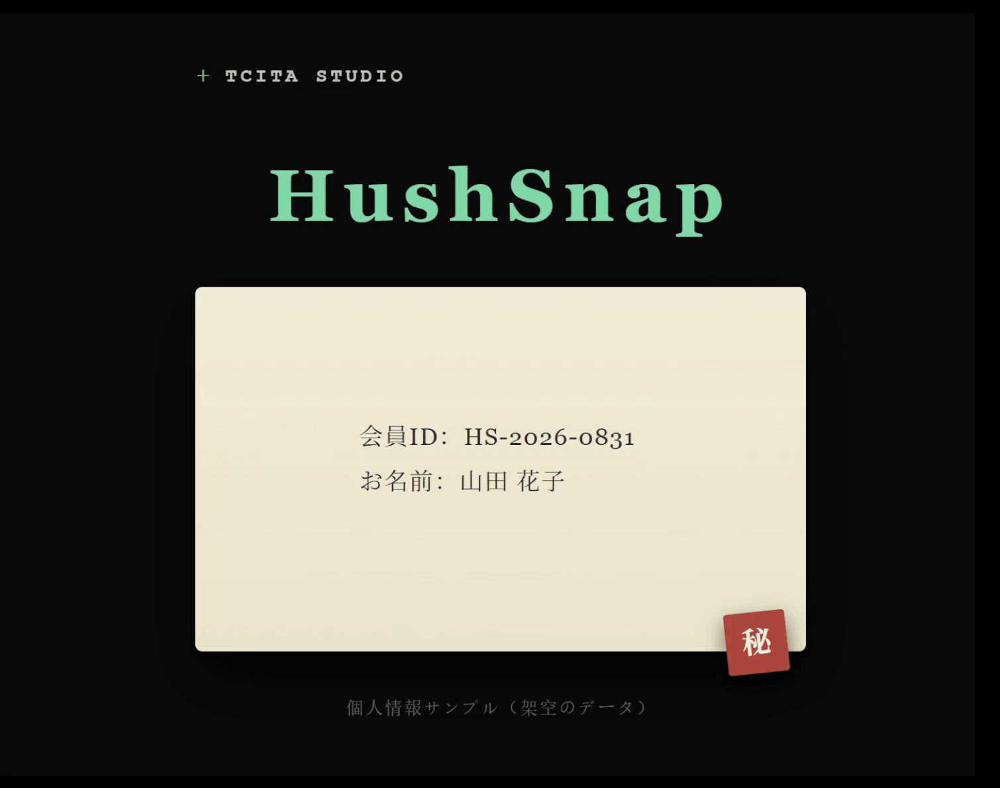

<div align="center">

[English](README.md) | **简体中文**

</div>

<div align="center">
  
  <h1>HushSnap</h1>
  <a href="https://apps.microsoft.com/detail/9p0qzv5z8njz">
    
  </a>
</div>

<br><br>

<table align="center" width="600">
<tr>
<td align="left">

**HushSnap 是一款理念鲜明、刻意保持极简的截图工具，核心是一个缩略图中心。** 按下快捷键、框选区域，截图即完成——没有悬浮工具栏，也没有二次确认。截图会即时进入剪贴板。

右下角会淡入一张小缩略图。**它就是交互界面：** 用上面的按钮编辑或置顶，拖拽保存，单击做 OCR。**识别出的文字会以排版干净、可直接编辑的布局弹出来。** 平时 HushSnap 安静地待在托盘里。全程本地运行——截图和识别文字不会离开你的设备。

[HushSnap 官网](https://tcita.github.io/HushSnap/)

[演示视频](https://youtu.be/untWW6_Ea3M)

[爱发电 (支持作者)](https://afdian.com/a/tcita)

</td>
</tr>
</table>

<table>
  <tr>
    <td align="center"><b>点击缩略图 → OCR</b></td>
    <td align="center"><b>拖拽缩略图 → 保存</b></td>
    <td align="center"><b>编辑 → 涂抹遮挡</b></td>
  </tr>
  <tr>
    <td></td>
    <td></td>
    <td></td>
  </tr>
</table>

截图后，屏幕右下角会淡入一张缩略图。这张缩略图是 HushSnap 截图后流程的核心：

- **悬停**可暂停自动隐藏，并弹出操作条，包含**编辑**、**置顶**、**关闭**按钮。
- **拖放**缩略图到任意位置即可保存图片——拖进聊天窗口、邮件、文件夹或其他应用。
- **左键单击**缩略图运行 **OCR**。识别文字会在悬浮弹窗中打开，可编辑、复制、调整大小，也可置顶保持可见。
- **编辑**（操作条上的画笔按钮）打开内置**图片编辑器**——完整工具集见下文 [图片编辑器](#图片编辑器)。
- **右键单击**缩略图可**查看原图**（用默认看图软件打开）、**复制图片**到剪贴板，或**保存到桌面**。
- 可在设置 - 截图中给缩略图左上角叠加藤蔓装饰，纯装饰效果，不影响点击区域和任何行为。
- 在设置中开启**后台 OCR 预取**，每次截图后会在后台静默识别，让缩略图弹窗秒开。它只预热缓存，不会动你的剪贴板。


## 更新日志

完整更新日志见 [**what's new.txt**](what's%20new.txt)（简体中文、繁体中文、English、日本語，新版本在前）。


随着项目持续迭代，本 README 的部分内容可能偶尔落后于最新行为或功能。

## 图片编辑器

内置图片编辑器可从缩略图的**编辑**按钮打开，或从置顶图片的右键菜单打开。这是一个轻量深色窗口，用于在分享前简单处理截图——标注、打码、裁剪、旋转、缩放，然后复制到剪贴板或保存。窗口会在光标所在屏幕居中打开，并记住上次的窗口大小。

**工具：** 矩形 / 椭圆 / 直线（颜色、粗细、填充、可选箭头）、文字（字体、字号、颜色）、画笔、荧光笔、马赛克（像素化打码）、橡皮擦、抓手，以及裁剪 / 旋转 / 缩放变换。另有撤销/重做（`Ctrl+Z` / `Ctrl+Y`）、适应窗口（`Ctrl+0`）、复制和另存为…（`Ctrl+S`，支持 PNG / JPEG / BMP）。变换以原子会话方式运行——**Esc** 取消——编辑中途状态明确不混乱。


## OCR 引擎

HushSnap 使用 [**PP-OCRv6**](https://github.com/PaddlePaddle/PaddleOCR) 作为唯一 OCR 引擎：

- **PP-OCRv6（经由 RapidOCR）：** 通过 [`rapidocr`](https://github.com/RapidAI/RapidOCR) Python 包在进程内运行 PP-OCRv6 small ONNX 模型（Apache 2.0）。无需外部依赖和语言包，离线可用。使用统一多语言模型，单个 7.7M 参数模型覆盖 **50 种语言**——以更小的体积超越了上一代 v5 server 模型的精度。

开箱即支持以下 50 种语言：

**核心：** 简体中文、繁体中文、英语、日语

**拉丁字母（46 种）：** 法语、德语、意大利语、西班牙语、葡萄牙语、荷兰语、波兰语、罗马尼亚语、捷克语、瑞典语、挪威语、丹麦语、芬兰语、匈牙利语、土耳其语、越南语、印尼语、马来语、阿塞拜疆语、南非荷兰语、波斯尼亚语、克罗地亚语、威尔士语、爱沙尼亚语、爱尔兰语、冰岛语、库尔德语、立陶宛语、拉脱维亚语、马耳他语、毛利语、奥克语、斯洛伐克语、斯洛文尼亚语、阿尔巴尼亚语、斯瓦希里语、他加禄语、乌兹别克语、拉丁语、塞尔维亚语（拉丁字母）、加泰罗尼亚语、巴斯克语、加利西亚语、卢森堡语、罗曼什语、克丘亚语

### 精简 cv2 构建

发布的 MSIX 经过瘦身：HushSnap 使用自制的 **24.8 MB 静态 `cv2.pyd`**，替代官方 82 MB 的 `opencv-python` wheel——体积减少 70%，OCR 输出逐字节一致（这只是体积优化，用标准 pip wheel 也能正常工作）。精简包已提交在本仓库（`third_party/` 二进制 + 仓库根目录的 `cv2/` 包，开发和测试直接引用）。当 OpenCV 或 Python 版本变化时重新构建：

```powershell
pwsh scripts/build/build_minimal_opencv.ps1 -NoIPP -ForceClean
```

## 第三方致谢

设计参考：[Text-Grab](https://github.com/TheJoeFin/Text-Grab)（MIT，OCR 流程）、[Pinta](https://github.com/PintaProject/Pinta)（MIT，图片编辑器工具集）、[ShareX](https://github.com/ShareX/ShareX)（GPL-3.0，截图流程）。基于 [PyQt6](https://www.riverbankcomputing.com/software/pyqt/) 构建（GPL-3.0-only，© Riverbank Computing Limited）——全部归属见 `THIRD_PARTY_NOTICES.md`。

## 许可证

HushSnap 基于 **GNU 通用公共许可证 v3.0** 分发（[LICENSE.md](LICENSE.md)）。第三方归属见 `THIRD_PARTY_NOTICES.md`。

Copyright © 2026 HushSnap。

## 开发与调试

安装依赖：

```powershell
pip install -r requirements.txt
```

从源码运行：

```powershell
python HushSnap.py
```

开启调试模式：在 `hushsnap_config.toml` 中设置 `debug = true`（`--debug` 命令行参数已移除，因为 MSIX 包无法接收命令行参数）。

**调试模式要点：**

- **隔离：** 从源码运行时使用 `%LOCALAPPDATA%\HushSnap_Dev`，不会污染正式版设置。
- **可追溯：** 日志等级设为 `DEBUG`，启动时自动打开日志文件夹。
- **实时输出：** 通过日志控制台处理器（`StreamHandler`）向终端实时输出日志。
- **OCR 检查：** 调试模式会把检测框图存到数据目录。右键托盘图标 → “打开配置文件夹” 即可直达：
  - `ocr_debug_words.png` - PP-OCR 检测器原始单词框（红色）
  - `ocr_debug_lines.png` - 聚类后的行框（绿色，L0/L1/… 编号）
  - 源码运行：`%LOCALAPPDATA%\HushSnap_Dev\`
  - 打包运行（MSIX）：`%LOCALAPPDATA%\Packages\<PackageFamilyName>\LocalState\`
  - 打包运行（PyInstaller 单文件）：`%LOCALAPPDATA%\HushSnap\`

## 构建（MSIX）

```powershell
build_msix.bat              # 构建未签名 MSIX；版本号从 git tag 自动解析
sign_for_local_test.bat     # 自签名，用于本地安装测试
```

构建要求 HEAD 位于某个 git tag 上（例如 `v0.3.0`）。本地测试时，`sign_for_local_test.bat` 会自动创建自签名证书并信任——请以管理员身份运行。

每次发布都会打 git tag —— `git checkout v1.5.4`，运行 `build_msix.bat`，再运行 `sign_for_local_test.bat` 即可生成该版本可本地安装的 MSIX。

更新日志（四种语言，新版本在前）在 [`what's new.txt`](what's%20new.txt)。

---

## 安装

HushSnap 仅通过 [Microsoft Store](https://apps.microsoft.com/detail/9p0qzv5z8njz) 分发。
