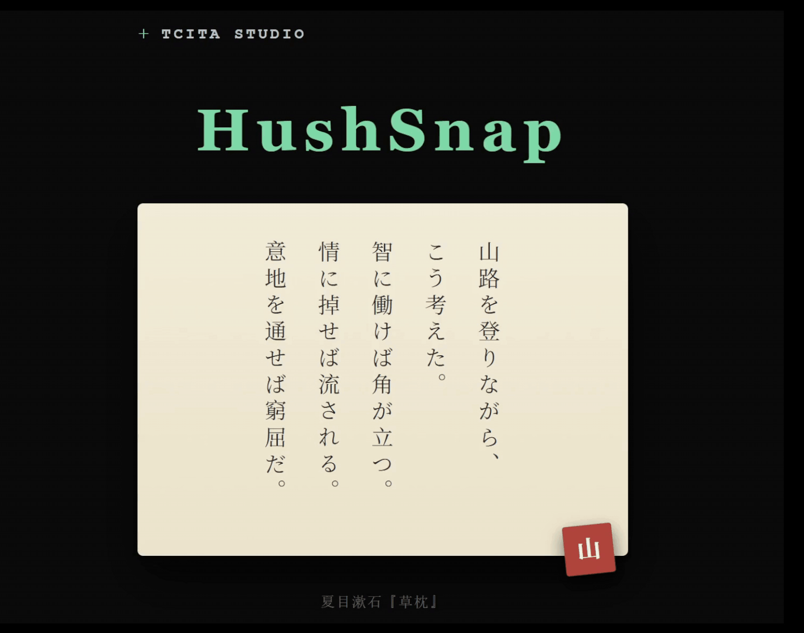
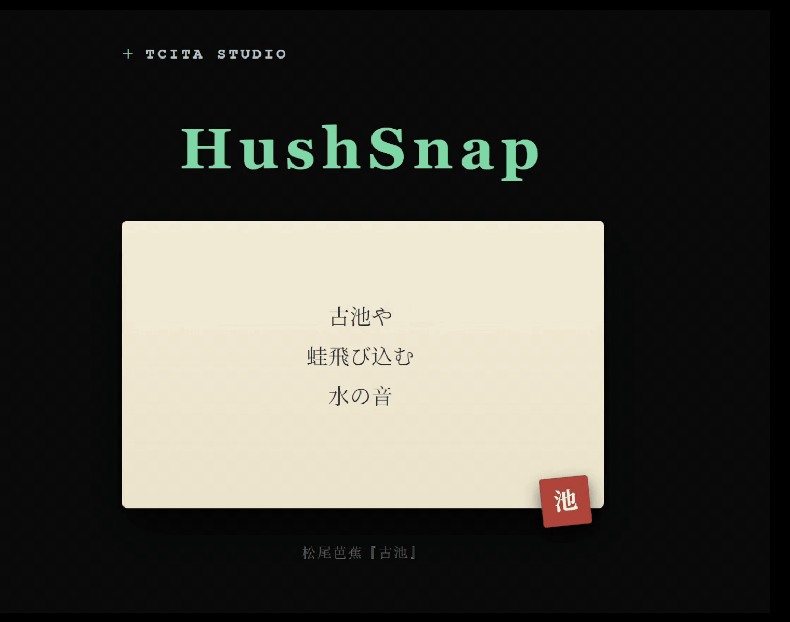
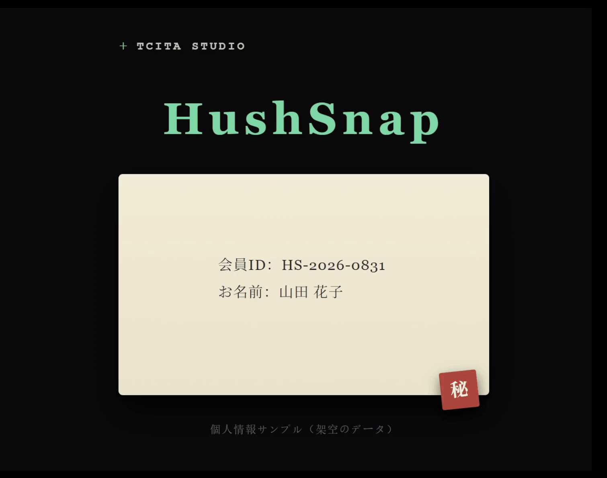

<div align="center">

[English](README.md) | **简体中文**

</div>

<div align="center">
  
  <h1>HushSnap</h1>
  <a href="https://apps.microsoft.com/detail/9p0qzv5z8njz">
    
  </a>
</div>

<br><br>

<table align="center" width="600">
<tr>
<td align="left">

**HushSnap 是一款理念鲜明、刻意保持极简的截图工具，一切交互都围绕一张缩略图展开。** 按下快捷键、框选区域，截图即完成——没有悬浮工具栏，也没有二次确认。截图会即时进入剪贴板。

右下角会淡入一张小缩略图。**它就是交互界面：** 用它上面的按钮编辑或置顶，拖拽保存，单击做 OCR。**识别出的文字会弹出来，排版干净，可以直接编辑。** 平时 HushSnap 安静地待在托盘里。全程本地运行——截图和识别文字不会离开你的设备。

**系统要求：** Windows 10 1809 及以上或 Windows 11（x64）。HushSnap 仅支持 Windows——依赖 Win32 API 并以 MSIX 包分发，不支持 Linux / macOS。

[HushSnap 官网](https://tcita.github.io/HushSnap/)

[演示视频（YouTube）](https://youtu.be/untWW6_Ea3M)

[演示视频（哔哩哔哩）](https://www.bilibili.com/video/BV1FquL6iESH)

</td>
</tr>
</table>

<table>
  <tr>
    <td align="center"><b>点击缩略图 → OCR</b></td>
    <td align="center"><b>拖拽缩略图 → 保存</b></td>
    <td align="center"><b>编辑 → 打码</b></td>
  </tr>
  <tr>
    <td></td>
    <td></td>
    <td></td>
  </tr>
</table>

截图后，屏幕右下角会淡入一张缩略图。后续操作都围绕它展开：

- **悬停**可暂停自动隐藏，并弹出一条操作条，上面有**编辑**、**置顶**、**关闭**按钮。
- **拖放**缩略图到任意位置即可保存图片——拖进聊天窗口、邮件、文件夹或其他应用。
- **左键单击**缩略图运行 **OCR**。识别文字会显示在悬浮弹窗里，可编辑、复制、调整大小，也可置顶保持可见。
- **编辑**（操作条上的画笔按钮）打开内置**图片编辑器**——完整工具集见下文 [图片编辑器](#图片编辑器)。
- **右键单击**缩略图可**查看原图**（用默认看图软件打开）、**复制图片**到剪贴板，或**保存到桌面**。
- 可在设置 → 截图中给缩略图左上角叠加藤蔓装饰，纯装饰效果，不影响点击区域和任何行为。
- 在设置中开启**后台 OCR 预取**，每次截图后会在后台静默识别，让缩略图弹窗秒开。它只预热缓存，不会动你的剪贴板。


## 更新日志

完整更新日志见 [**what's new.txt**](what's%20new.txt)（简体中文、繁体中文、English、日本語，新版本在前）。


随着项目持续迭代，本 README 的部分内容可能与实际功能略有出入。

## 图片编辑器

内置图片编辑器可从缩略图的**编辑**按钮打开，或从置顶图片的右键菜单打开。这是一个轻量深色窗口，用于在分享前简单处理截图——标注、打码、裁剪、旋转、缩放，然后复制到剪贴板或保存。窗口会在光标所在屏幕居中打开，并记住上次的窗口大小。

**工具：** 矩形、椭圆、直线（颜色、粗细、填充、可选箭头）、文字（字体、字号、颜色）、画笔、荧光笔、马赛克（像素化打码）、橡皮擦、抓手，以及裁剪、旋转、缩放变换。另有撤销、重做（`Ctrl+Z`、`Ctrl+Y`）、适应窗口（`Ctrl+0`）、复制和另存为…（`Ctrl+S`，支持 PNG、JPEG、BMP）。变换是一次整体操作，按 **Esc** 可取消，不会留下改到一半的中间状态。


## OCR 引擎

HushSnap 使用 [**PP-OCRv6**](https://github.com/PaddlePaddle/PaddleOCR) 作为唯一 OCR 引擎：

- **PP-OCRv6（经由 RapidOCR）：** 通过 [`rapidocr`](https://github.com/RapidAI/RapidOCR) Python 包在进程内运行 PP-OCRv6 small ONNX 模型（Apache 2.0）。无需外部依赖和语言包，离线可用。使用统一多语言模型，单个 7.7M 参数模型覆盖 **50 种语言**——以更小的体积超越了上一代 v5 server 模型的精度。

开箱即支持以下 50 种语言：

**核心：** 简体中文、繁体中文、英语、日语

**拉丁字母（46 种）：** 法语、德语、意大利语、西班牙语、葡萄牙语、荷兰语、波兰语、罗马尼亚语、捷克语、瑞典语、挪威语、丹麦语、芬兰语、匈牙利语、土耳其语、越南语、印尼语、马来语、阿塞拜疆语、南非荷兰语、波斯尼亚语、克罗地亚语、威尔士语、爱沙尼亚语、爱尔兰语、冰岛语、库尔德语、立陶宛语、拉脱维亚语、马耳他语、毛利语、奥克语、斯洛伐克语、斯洛文尼亚语、阿尔巴尼亚语、斯瓦希里语、他加禄语、乌兹别克语、拉丁语、塞尔维亚语（拉丁字母）、加泰罗尼亚语、巴斯克语、加利西亚语、卢森堡语、罗曼什语、克丘亚语

### 精简 cv2 构建

发布的 MSIX 经过瘦身：HushSnap 使用自制的 **24.8 MB 静态 `cv2.pyd`**，替代官方 82 MB 的 `opencv-python` wheel——体积减少 70%，OCR 输出逐字节一致（这只是体积优化，用标准 pip wheel 也能正常工作）。精简包已包含在仓库中（`third_party/` 二进制，以及仓库根目录的 `cv2/` 包，开发和测试直接引用）。OpenCV 或 Python 版本变化时需重新构建：

```powershell
pwsh scripts/build/build_minimal_opencv.ps1 -NoIPP -ForceClean
```

## 设计参考

- [Text-Grab](https://github.com/TheJoeFin/Text-Grab)（MIT）——OCR 流程
- [Pinta](https://github.com/PintaProject/Pinta)（MIT）——图片编辑器工具集
- [ShareX](https://github.com/ShareX/ShareX)（GPL-3.0）——截图流程

全部第三方归属与许可证信息见 `THIRD_PARTY_NOTICES.md`。

**特别致谢：** [RapidOCR](https://github.com/RapidAI/RapidOCR)（Apache 2.0）——HushSnap 的整套 OCR 推理及随应用分发的 PP-OCRv6 模型均由该 Python 包提供。

## 许可证

HushSnap 依据 **GNU 通用公共许可证 v3.0** 发布（[LICENSE.md](LICENSE.md)）。第三方归属见 `THIRD_PARTY_NOTICES.md`。

Copyright © 2026 HushSnap.

## 开发与调试

需要 **Python 3.13（64 位）**：仓库内的精简 `cv2.pyd` 与 ONNX Runtime 按该版本构建，其他版本会在 `import cv2` 处失败。

安装依赖：

```powershell
pip install -r requirements.txt
```

从源码运行（项目根目录）：

```powershell
python HushSnap.py
```

若已运行 Microsoft Store 版本，请先退出托盘图标——单实例检测会让源码实例直接退出。源码运行默认开启调试模式，配置文件在 `%LOCALAPPDATA%\HushSnap_Dev\hushsnap_config.toml`；如需关闭，设置 `debug = false`（`--debug` 命令行参数已移除，因为 MSIX 包无法接收命令行参数）。

运行测试：`pwsh scripts/run_tests.ps1`（自动选用 `.venv` / 当前虚拟环境 / PATH 中的 Python，也可直接传 pytest 参数）。仓库根目录的 `_stubs/` 仅供 PyInstaller 打包使用，源码运行无需配置。

**调试模式要点：**

- **隔离：** 从源码运行时使用 `%LOCALAPPDATA%\HushSnap_Dev`，不会污染正式版设置。
- **可追溯：** 日志等级设为 `DEBUG`，启动时自动打开日志文件夹。
- **实时输出：** 日志同时输出到终端（`StreamHandler`）。
- **OCR 检查：** 调试模式会把检测框图存到数据目录。右键托盘图标 → “打开配置文件夹” 即可直达：
  - `ocr_debug_words.png` — PP-OCR 检测器原始单词框（红色）
  - `ocr_debug_lines.png` — 聚类后的行框（绿色，L0/L1/… 编号）
  - 源码运行：`%LOCALAPPDATA%\HushSnap_Dev\`
  - 打包运行（MSIX）：`%LOCALAPPDATA%\Packages\<PackageFamilyName>\LocalState\`
  - 打包运行（PyInstaller 单文件）：`%LOCALAPPDATA%\HushSnap\`

## 构建（MSIX）

前置条件：Windows 10/11 SDK（提供 `makeappx.exe` 与 `signtool.exe`）、[`uv`](https://docs.astral.sh/uv/) 在 PATH，以及 Python 3.13（64 位）。在项目根目录以命令行运行：

```powershell
build_msix.bat              # 构建未签名 MSIX → dist-installer\HushSnap.msix
sign_for_local_test.bat     # 自签名 → dist-installer-test\HushSnap_Test_Signed.msix
```

`build_msix.bat` 会先运行完整单元测试，失败即中止；版本号默认从当前 git tag 解析，因此 HEAD 需指向某个 tag（例如 `v0.3.0`）。tag 约定：正式发布只写三段 `vX.Y.Z`；带第四位的（如 `v1.6.4.1`）仅用于本地构建测试，不发布。只想本地试构建、不想打 tag 时：

```powershell
build_msix.bat -Version 0.0.0
```

`-SkipTests` 只跳过测试，其余校验照常；完整参数见 `installer/build_msix.ps1` 顶部的 `param` 块。

签名前必须先完成上面的构建（脚本读取 `dist-installer\HushSnap.msix`）。`sign_for_local_test.bat` **需以管理员身份运行**：它会复用或创建一张与包 Publisher 匹配的自签名证书，加入本机的「受信任的根证书颁发机构」与「受信任的人」，再用 `signtool` 签名。完成后**双击 `dist-installer-test\HushSnap_Test_Signed.msix` 即可安装**。

要生成某个历史版本的本地安装包，先 `git checkout vX.Y.Z`，再依次运行上面两个脚本即可。

---

## 安装

HushSnap 仅通过 [Microsoft Store](https://apps.microsoft.com/detail/9p0qzv5z8njz) 分发。
